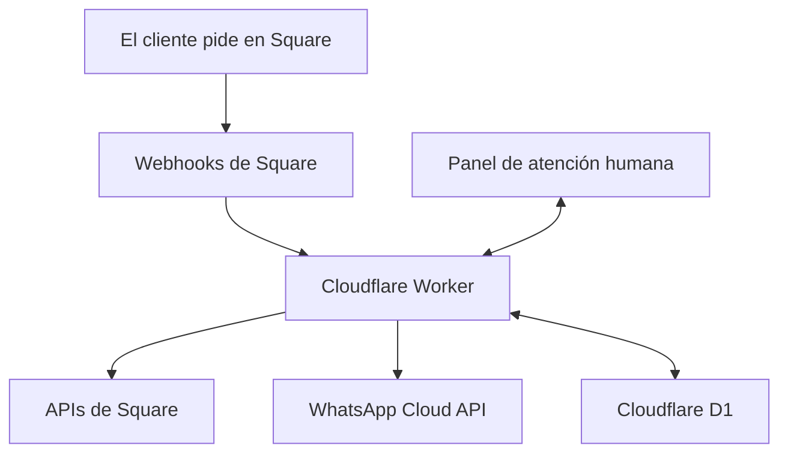

# Automatización de Pedidos Square + WhatsApp

[English](README.md) · [Português (Brasil)](README.pt-BR.md) · **Español**

[](https://github.com/omesis-sec/square-whatsapp-order-automation/actions/workflows/ci.yml)

Automatización de pedidos probada en producción para **Sabor do Brasil
Toronto**, una microempresa canadiense de alimentos que opera a través de Square
Online. El sistema conecta los pedidos de Square con WhatsApp, ofrece a los
clientes seguimiento de autoservicio, envía actualizaciones automáticas de
estado y proporciona una bandeja sencilla de atención humana.

> Este es un caso de estudio de portafolio sin datos sensibles. No se incluyen
> credenciales de producción ni datos de clientes. El uso comercial requiere
> permiso; consulte [NOTICE.md](NOTICE.md).

> La documentación técnica en `docs/` y `postman/` está en inglés.

## Por qué lo construí

Este proyecto comenzó con un pequeño negocio de propietarios brasileños en
Canadá que atiende principalmente a clientes brasileños. WhatsApp forma parte de
la comunicación cotidiana en Brasil, por lo que los clientes esperaban usarlo
para hacer preguntas, recibir actualizaciones y seguir sus pedidos. Square ya
se encargaba de la tienda, el pago, los cobros y la gestión de pedidos, pero su
experiencia en línea gratuita no conectaba esas operaciones con el canal de
comunicación que más usaba el público objetivo.

Construí esta automatización para convertir un flujo informal y muy manual en
una experiencia de atención al cliente consistente y profesional. La integración
mantiene a Square como fuente de verdad y usa la API oficial WhatsApp Cloud para
confirmaciones de pedido, actualizaciones automáticas de estado, seguimiento de
autoservicio y acceso a atención humana.

Aunque la primera implementación se creó para un negocio de alimentos, la
arquitectura no se limita a restaurantes. Puede adaptarse a otros pequeños
negocios que gestionan pedidos con Square y quieren comunicarse con sus clientes
por WhatsApp, sin depender de otra plataforma SaaS con cuota mensual.

## Capacidades verificadas en producción

- Confirmación automática por WhatsApp tras un pago completado en Square
- Notificaciones automáticas para **Being prepared** (en preparación), **Ready
  for delivery** (listo para entrega), **Delivered** (entregado) y **Canceled**
  (cancelado)
- Seguimiento de pedidos vinculado al teléfono, sin pedir al cliente que vuelva
  a escribir el número de pedido cuando el vínculo ya se conoce
- Consulta manual de pedidos como alternativa
- Menú bilingüe inglés/portugués para el cliente
- Información de menú, entrega, horarios, alérgenos y pago
- Transferencia a atención humana mediante una bandeja web protegida
- Flujo de **Return to bot** (volver al bot) después de la atención humana
- Baja con `STOP` y reactivación controlada por el cliente
- Protección contra eventos duplicados y persistencia del estado de entrega
- Firmas de webhook de Square y Meta verificadas
- Retención y limpieza en D1 para registros de soporte y de notificaciones

El mensaje inicial, los cambios automáticos de estado, la transferencia a
atención humana, el regreso al bot, la baja/reactivación y el primer contacto con
un número de WhatsApp canadiense completamente nuevo se probaron de extremo a
extremo antes de preparar este repositorio.

## Arquitectura



Square sigue siendo la fuente de verdad de los pedidos. El Worker valida cada
webhook, obtiene el pedido completo, determina el teléfono de entrega, aplica las
reglas de consentimiento y deduplicación y luego envía la plantilla utility
correcta de Meta. D1 almacena vínculos de seguimiento, acuses de entrega, estado
de consentimiento y mensajes de soporte.

## Tecnología

- Módulos ES de JavaScript
- Cloudflare Workers
- Cloudflare D1 / SQLite
- APIs Square Orders, Payments y Customers
- Webhooks de Square
- WhatsApp Cloud API y plantillas utility aprobadas
- Verificación HMAC con Web Crypto
- Test runner nativo de Node.js

## Estructura del repositorio

```text
src/worker.mjs                    Cloudflare Worker
test/customer-flow.test.mjs       Flujos de menú y seguimiento manual
test/order-notification.test.mjs  Primer contacto, baja y deduplicación
test/support-flow.test.mjs        Atención humana y regreso al bot
test/helpers/runtime.mjs          Dobles de prueba compartidos de D1 y Cache API
migrations/0001_initial.sql       Referencia del esquema de D1
docs/deployment.md                Despliegue y configuración de plantillas
docs/troubleshooting.md           Guía de fallos por síntoma
postman/                          Colección de Postman y entorno local
scripts/check-json.mjs            Valida package.json y los JSON de Postman
.github/workflows/ci.yml          Ejecuta npm run validate en push y PRs
.dev.vars.example                 Variables para wrangler dev local
wrangler.toml.example             Configuración de Cloudflare sin datos sensibles
```

## Ejecutar las pruebas `.mjs`

Requisitos: Node.js 22.5 o superior. Se recomienda Node.js 24 porque la suite de
pruebas usa el módulo nativo `node:sqlite`.

```bash
git clone https://github.com/omesis-sec/square-whatsapp-order-automation.git
cd square-whatsapp-order-automation
npm ci
npm run validate
```

Ejecutar un flujo directamente:

```bash
node test/support-flow.test.mjs
```

El Worker es un módulo ES para el entorno de Cloudflare, no un servidor de
terminal independiente. `node src/worker.mjs` solo carga el módulo. Use las
pruebas para la verificación local o Wrangler para un entorno local del Worker.

## Worker local y Postman

```bash
cp wrangler.toml.example wrangler.toml   # luego reemplace los IDs de ejemplo
cp .dev.vars.example .dev.vars           # secretos de prueba locales, nunca haga commit
npm run dev                              # http://localhost:8787
```

Importe los archivos de [postman/](postman/) y seleccione el entorno
**Square WhatsApp - Local (wrangler dev)**. Los secretos del entorno deben
coincidir con los de `.dev.vars`. Consulte [postman/README.md](postman/README.md).
Si algo falla, empiece por [docs/troubleshooting.md](docs/troubleshooting.md).

## Configuración

### Token de acceso permanente de Meta

Los despliegues en producción deben usar un **token de acceso de System User de
Meta configurado para no expirar nunca**, y no el token temporal que muestra el
panel **Getting Started** de WhatsApp. El Worker espera esta credencial en
`META_ACCESS_TOKEN`.

En la configuración de Meta Business:

1. Abra **Users → System users** y cree o seleccione un system user con el rol
   **Admin**.
2. En **Assigned assets**, otorgue a ese system user **Full control** de la app
   de Meta usada en esta integración.
3. Asigne la **WhatsApp Business Account (WABA)** de producción al mismo system
   user con **Full control**.
4. Seleccione **Generate token**, elija la app y, cuando Meta presente la opción
   de expiración del token, elija **Never expires**.
5. Otorgue `whatsapp_business_management` y `whatsapp_business_messaging`.
6. Copie el token cuando se muestre y guárdelo directamente como un secreto
   cifrado de Cloudflare:

```bash
npx wrangler secret put META_ACCESS_TOKEN
```

**No** haga commit del token generado en este repositorio, en archivos `.env` ni
en `wrangler.toml`. Un token sin expiración programada puede dejar de funcionar
si se revoca manualmente, se elimina el system user o se retira el acceso a la
app/WABA.

Cree una base de datos D1 vinculada como `SUPPORT_DB`, copie
`wrangler.toml.example` a `wrangler.toml`, reemplace los IDs de ejemplo y defina
los seis valores sensibles mediante secretos cifrados de Cloudflare.

| Secreto | Finalidad |
|---|---|
| `ADMIN_PASSWORD` | Protege la bandeja de atención |
| `META_ACCESS_TOKEN` | Token permanente de System User de Meta usado para llamar a la WhatsApp Cloud API |
| `META_APP_SECRET` | Verifica las firmas de los webhooks de Meta |
| `META_VERIFY_TOKEN` | Verifica la URL de callback de Meta |
| `SQUARE_ACCESS_TOKEN` | Lee los pedidos de producción de Square |
| `SQUARE_WEBHOOK_SIGNATURE_KEY` | Verifica las firmas de los webhooks de Square |

Las variables en texto plano importantes incluyen el ID del número de teléfono de
Meta, nombres/idiomas de las plantillas aprobadas, URL/versión/ubicación de la
API de Square, URL del menú, zona horaria del negocio y la URL de notificación
exacta de Square. La lista completa está en
[.dev.vars.example](.dev.vars.example) y [docs/deployment.md](docs/deployment.md).

## Endpoints de webhook

| Endpoint | Método | Finalidad |
|---|---:|---|
| `/webhooks/square` | `POST` | Eventos de pago y de pedido |
| `/webhooks/whatsapp` | `GET` / `POST` | Verificación de Meta y mensajes |
| `/support` | `GET` | Bandeja de atención humana autenticada |

Suscriba el webhook de Square a:

- `payment.created`
- `payment.updated`
- `order.updated`
- `order.fulfillment.updated`

## Plantillas de mensaje

Se usan dos plantillas **Utility / English (US)** aprobadas:

1. `order_received_update` — la primera notificación de pedido pagado
2. `order_status_update` — cambios de estado posteriores

Ambas plantillas reciben tres parámetros en el cuerpo, en este orden exacto:
código del pedido, estado y total con formato. Ambas usan las mismas tres
respuestas rápidas: **Track order**, **More options** y **Talk to us**.

Consulte [docs/deployment.md](docs/deployment.md) para el texto exacto y la lista
de verificación de configuración.

## Decisiones de seguridad y privacidad

- Los secretos nunca se almacenan en el código fuente.
- Las solicitudes de Square y Meta se autentican antes de procesar su contenido.
- Los registros evitan nombres de clientes, números de teléfono y direcciones de
  entrega.
- Los eventos duplicados de pago y de estado son idempotentes.
- Un `STOP` previo siempre prevalece sobre el consentimiento presencial.
- Los datos de soporte y los registros de notificación se eliminan
  periódicamente.

Más detalles en [SECURITY.md](SECURITY.md).

## Limitaciones conocidas y hoja de ruta

El Worker se construyó para un único pequeño negocio y se probó de extremo a
extremo en ese caso de uso. Estos son los puntos que abordaría antes de un
despliegue para varios clientes:

| Área | Comportamiento actual | Mejora prevista |
|---|---|---|
| Eventos fallidos | Los webhooks responden `200` antes de procesar; si la API de Square está caída durante el procesamiento, el error se registra en el log pero el evento no se reintenta | Devolver `5xx` ante un fallo, o añadir cola/conciliación periódica de pagos `FAILED` y sin notificar |
| Deduplicación de WhatsApp | Usa el Cache API de Cloudflare, que está limitado a un centro de datos | Deduplicar por ID de mensaje en D1 |
| Consultas de seguimiento | Cada solicitud `TRACK` puede disparar varias llamadas a la API de Square y no hay límite por número | Límite de solicitudes por número o caché de corta duración del resultado |
| Acceso a la bandeja de atención | Una única contraseña Basic Auth compartida, comparada sin límite de intentos | Cloudflare Access delante de `/support` y comparación en tiempo constante |
| Retención de datos | La limpieza se ejecuta cuando la bandeja lista las conversaciones | Un Cron Trigger programado |
| Consentimiento | Los clientes sin registro de consentimiento se tratan como si hubieran consentido en persona antes del pedido (proceso del operador); un `STOP` previo siempre prevalece | Capturar y almacenar evidencia verificable de consentimiento; revisar normas locales como CASL |
| Esquema | Las tablas se crean en tiempo de ejecución y se reflejan en `migrations/0001_initial.sql` | Usar las migraciones de D1 como fuente única, con una prueba que detecte divergencias |
| Marca | El nombre del negocio, la URL de menú por defecto y los textos al cliente están ligados al negocio original | Configurarlos mediante variables |
| Organización del código | Worker en un solo archivo (`src/worker.mjs`) | Dividir en módulos de Square, WhatsApp, almacenamiento, bot y bandeja cuando la cobertura de pruebas sea mayor |
| Cobertura de pruebas | Los flujos se cubren de extremo a extremo; el rechazo de firmas, las notificaciones de cambio de estado y la autenticación de la bandeja no | Añadir esos casos |

## Dirección del producto

La arquitectura puede adaptarse a otros pequeños negocios canadienses que usan
Square para sus pedidos y quieren comunicarse con sus clientes por WhatsApp.
Ejemplos: restaurantes, servicios de catering, cocinas caseras, tiendas,
operaciones de entrega local y negocios de servicios con flujos basados en
pedidos. Un despliegue para un cliente requiere su propia aplicación de Square,
activos de negocio de Meta, número de WhatsApp, plantillas utility aprobadas,
cuenta de Cloudflare, política de privacidad y textos operativos.

Posibles próximas iteraciones incluyen conjuntos de plantillas multilingües,
roles de equipo, integración con servicios de reparto, analítica y un asistente
reutilizable de incorporación.

## Autor

Creado por **Iago Gomes** como un proyecto completo de automatización,
integración y experiencia del cliente para una microempresa de alimentos de
Toronto.

---

**Uso de IA:** diseñé la arquitectura y las integraciones con Square y WhatsApp,
y validé el sistema en producción para un negocio real. Desarrollé el proyecto
junto con Claude (Anthropic), que fue coautor del código del Worker y también
ayudó con el análisis, la documentación, la colección de Postman, el CI/las
herramientas y la refactorización de las pruebas. Dirigí y aprobé todos los
cambios.
