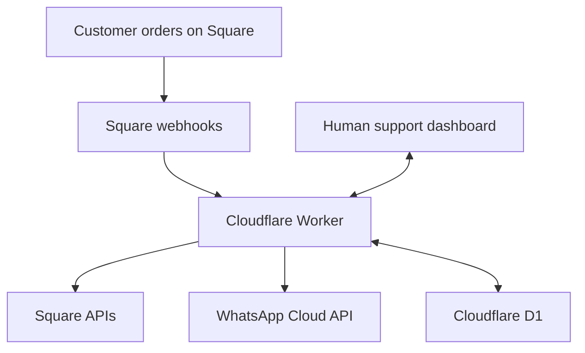

# Square + WhatsApp Order Automation

Production-tested order automation for **Sabor do Brasil Toronto**, a Canadian
food microbusiness operating through Square Online. The system connects Square
orders to WhatsApp, gives customers self-service tracking, sends automatic
status updates and provides a lightweight human-support inbox.

> This is a sanitized portfolio case study. Production credentials and customer
> data are not included. Commercial reuse requires permission; see
> [NOTICE.md](NOTICE.md).

## Why I built it

Small food businesses often accept orders online but still answer the same
questions manually: *Was my order received? Is it ready? When will it arrive?*
Square already handled the menu, checkout and payment, but its free storefront
did not provide the WhatsApp workflow the business needed.

I designed a serverless integration that keeps Square as the source of truth and
uses the official WhatsApp Cloud API for customer communication. The result is a
faster ordering experience without adding another monthly SaaS platform.

## Production-verified capabilities

- Automatic WhatsApp confirmation after a completed Square payment
- Automatic notifications for **Being prepared**, **Ready for delivery**,
  **Delivered** and **Canceled**
- Phone-linked order tracking without asking the customer to re-enter an order
  number when a link is already known
- Manual order lookup as a fallback
- Bilingual English/Portuguese customer menu
- Menu, delivery, hours, allergens and payment information
- Human handoff through a protected web inbox
- **Return to bot** flow after human support
- `STOP` opt-out and customer-controlled reactivation
- Duplicate-event protection and delivery-status persistence
- Verified Square and Meta webhook signatures
- D1 retention and cleanup for support and notification records

The initial message, automatic status changes, human handoff, return-to-bot flow,
opt-out/reactivation and first contact with a brand-new Canadian WhatsApp number
were all exercised end to end before this repository was prepared.

## Architecture



Square remains the order source of truth. The Worker validates each webhook,
retrieves the full order, resolves the delivery phone number, applies consent and
deduplication rules, then sends the correct Meta utility template. D1 stores
tracking links, delivery receipts, consent state and support messages.

## Technology

- JavaScript ES modules
- Cloudflare Workers
- Cloudflare D1 / SQLite
- Square Orders, Payments and Customers APIs
- Square webhooks
- WhatsApp Cloud API and approved utility templates
- Web Crypto HMAC verification
- Node.js built-in test runner

## Repository layout

```text
src/worker.mjs                    Cloudflare Worker
test/customer-flow.test.mjs       Menu and manual tracking flows
test/order-notification.test.mjs  First-contact, opt-out and deduplication
test/support-flow.test.mjs        Human handoff and return-to-bot flow
migrations/0001_initial.sql       D1 schema reference
docs/deployment.md                Deployment and template setup
wrangler.toml.example             Sanitized Cloudflare configuration
```

## Run the `.mjs` tests

Requirements: Node.js 22.5 or newer. Node.js 24 is recommended because the test
suite uses the built-in `node:sqlite` module.

```bash
git clone https://github.com/omesis-sec/square-whatsapp-order-automation.git
cd square-whatsapp-order-automation
npm run validate
```

Run one flow directly:

```bash
node test/support-flow.test.mjs
```

The Worker itself is an ES module for the Cloudflare runtime, not a standalone
terminal server. `node src/worker.mjs` only loads the module. Use the tests for
local verification or Wrangler for a local Worker runtime.

## Configuration

Create a D1 database bound as `SUPPORT_DB`, copy
`wrangler.toml.example` to `wrangler.toml`, replace the placeholder IDs and set
the six sensitive values through Cloudflare encrypted secrets.

| Secret | Purpose |
|---|---|
| `ADMIN_PASSWORD` | Protects the support inbox |
| `META_ACCESS_TOKEN` | Calls the WhatsApp Cloud API |
| `META_APP_SECRET` | Verifies Meta webhook signatures |
| `META_VERIFY_TOKEN` | Verifies the Meta callback URL |
| `SQUARE_ACCESS_TOKEN` | Reads production Square orders |
| `SQUARE_WEBHOOK_SIGNATURE_KEY` | Verifies Square webhook signatures |

Important plaintext variables include the Meta phone number ID, approved
template names/languages, Square API URL/version/location, menu URL, business
timezone and the exact Square notification URL. A complete list is provided in
[.env.example](.env.example) and [docs/deployment.md](docs/deployment.md).

## Webhook endpoints

| Endpoint | Method | Purpose |
|---|---:|---|
| `/webhooks/square` | `POST` | Payment and order events |
| `/webhooks/whatsapp` | `GET` / `POST` | Meta verification and messages |
| `/support` | `GET` | Authenticated human-support inbox |

Subscribe the Square webhook to:

- `payment.created`
- `payment.updated`
- `order.updated`
- `order.fulfillment.updated`

## Message templates

Two approved **Utility / English (US)** templates are used:

1. `order_received_update` — the first paid-order notification
2. `order_status_update` — subsequent status changes

Both templates receive three body parameters in this exact order: order code,
status and formatted total. Both use the same three quick replies: **Track
order**, **More options** and **Talk to us**.

See [docs/deployment.md](docs/deployment.md) for the exact bodies and setup
checklist.

## Security and privacy decisions

- Secrets are never stored in source code.
- Square and Meta requests are authenticated before payload processing.
- Logs avoid customer names, phone numbers and delivery addresses.
- Duplicate payment and status events are idempotent.
- A previous `STOP` always overrides in-person consent.
- Support data and notification records are periodically deleted.

More detail is available in [SECURITY.md](SECURITY.md).

## Product direction

The architecture can be adapted for other Canadian restaurants, caterers,
home-based kitchens and local delivery businesses using Square. A client rollout
requires its own Square application, Meta business assets, WhatsApp number,
approved utility templates, Cloudflare account, privacy policy and operational
copy.

Potential next iterations include multilingual template sets, team roles,
delivery-provider integration, analytics and a reusable onboarding wizard.

## Author

Built by **Iago Gomes** as an end-to-end automation, integration and customer
experience project for a Toronto food microbusiness.
