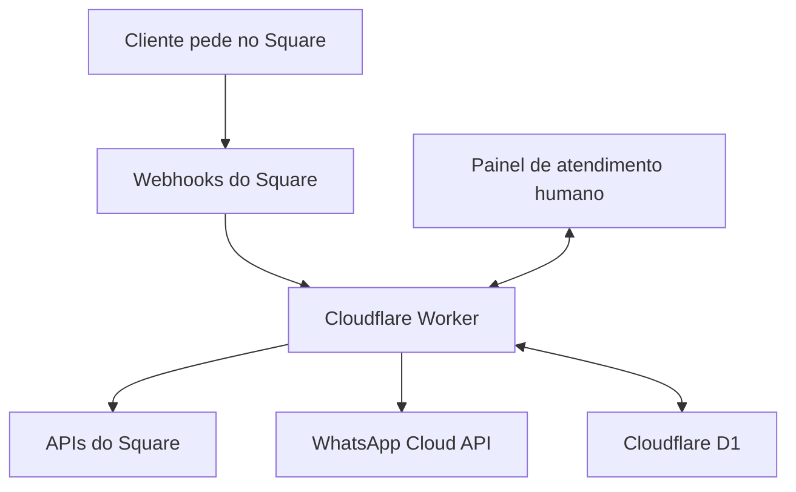

# Automação de Pedidos Square + WhatsApp

[English](README.md) · **Português (Brasil)** · [Español](README.es.md)

[](https://github.com/omesis-sec/square-whatsapp-order-automation/actions/workflows/ci.yml)

Automação de pedidos testada em produção para a **Sabor do Brasil Toronto**, uma
microempresa canadense de alimentos que opera pelo Square Online. O sistema
conecta os pedidos do Square ao WhatsApp, oferece rastreamento de autoatendimento
ao cliente, envia atualizações automáticas de status e fornece uma caixa de
atendimento humano simples.

> Este é um estudo de caso de portfólio sem dados sensíveis. Credenciais de
> produção e dados de clientes não estão incluídos. O uso comercial exige
> permissão; veja [NOTICE.md](NOTICE.md).

> A documentação técnica em `docs/` e `postman/` está em inglês.

## Por que eu criei

Este projeto começou com um pequeno negócio de proprietários brasileiros no
Canadá, que atende principalmente clientes brasileiros. O WhatsApp faz parte do
dia a dia da comunicação no Brasil, então os clientes naturalmente esperavam
usá-lo para tirar dúvidas, receber atualizações e acompanhar seus pedidos. O
Square já cuidava da loja, do checkout, dos pagamentos e da gestão de pedidos,
mas sua experiência online gratuita não conectava essas operações ao canal de
comunicação que o público-alvo mais usava.

Criei esta automação para transformar um fluxo informal e muito manual em uma
experiência de atendimento consistente e profissional. A integração mantém o
Square como fonte da verdade e usa a API oficial WhatsApp Cloud para
confirmações de pedido, atualizações automáticas de status, rastreamento de
autoatendimento e acesso ao atendimento humano.

Embora a primeira implementação tenha sido feita para um negócio de alimentos, a
arquitetura não se limita a restaurantes. Ela pode ser adaptada a outros
pequenos negócios que gerenciam pedidos pelo Square e querem se comunicar com
seus clientes pelo WhatsApp, sem depender de mais uma plataforma SaaS com
mensalidade.

## Recursos verificados em produção

- Confirmação automática no WhatsApp após um pagamento concluído no Square
- Notificações automáticas para **Being prepared** (em preparo), **Ready for
  delivery** (pronto para entrega), **Delivered** (entregue) e **Canceled**
  (cancelado)
- Rastreamento de pedido vinculado ao telefone, sem pedir ao cliente que digite
  de novo o número do pedido quando o vínculo já é conhecido
- Consulta manual de pedido como alternativa
- Menu bilíngue inglês/português para o cliente
- Informações de cardápio, entrega, horários, alérgenos e pagamento
- Transferência para atendimento humano por uma caixa web protegida
- Fluxo de **Return to bot** (voltar ao bot) após o atendimento humano
- Cancelamento com `STOP` e reativação controlada pelo cliente
- Proteção contra eventos duplicados e persistência do status de entrega
- Assinaturas de webhook do Square e da Meta verificadas
- Retenção e limpeza no D1 para registros de suporte e de notificações

A mensagem inicial, as mudanças automáticas de status, a transferência para
atendimento humano, o retorno ao bot, o cancelamento/reativação e o primeiro
contato com um número de WhatsApp canadense totalmente novo foram testados de
ponta a ponta antes de este repositório ser preparado.

## Arquitetura



O Square continua sendo a fonte da verdade dos pedidos. O Worker valida cada
webhook, busca o pedido completo, identifica o telefone de entrega, aplica as
regras de consentimento e de deduplicação e então envia o template utility
correto da Meta. O D1 armazena vínculos de rastreamento, confirmações de entrega,
estado de consentimento e mensagens de suporte.

## Tecnologia

- Módulos ES em JavaScript
- Cloudflare Workers
- Cloudflare D1 / SQLite
- APIs Square Orders, Payments e Customers
- Webhooks do Square
- WhatsApp Cloud API e templates utility aprovados
- Verificação HMAC com Web Crypto
- Test runner nativo do Node.js

## Estrutura do repositório

```text
src/worker.mjs                    Cloudflare Worker
test/customer-flow.test.mjs       Fluxos de menu e rastreamento manual
test/order-notification.test.mjs  Primeiro contato, opt-out e deduplicação
test/support-flow.test.mjs        Atendimento humano e retorno ao bot
test/helpers/runtime.mjs          Mocks compartilhados de D1 e Cache API
migrations/0001_initial.sql       Referência do schema do D1
docs/deployment.md                Implantação e configuração de templates
docs/troubleshooting.md           Guia de falhas por sintoma
postman/                          Coleção do Postman e ambiente local
scripts/check-json.mjs            Valida package.json e os JSONs do Postman
.github/workflows/ci.yml          Executa npm run validate em push e PRs
.dev.vars.example                 Variáveis para wrangler dev local
wrangler.toml.example             Configuração Cloudflare sem dados sensíveis
```

## Executar os testes `.mjs`

Requisitos: Node.js 22.5 ou superior. O Node.js 24 é recomendado porque a suíte
de testes usa o módulo nativo `node:sqlite`.

```bash
git clone https://github.com/omesis-sec/square-whatsapp-order-automation.git
cd square-whatsapp-order-automation
npm ci
npm run validate
```

Executar um fluxo diretamente:

```bash
node test/support-flow.test.mjs
```

O Worker é um módulo ES para o runtime da Cloudflare, não um servidor de
terminal independente. `node src/worker.mjs` apenas carrega o módulo. Use os
testes para verificação local ou o Wrangler para um runtime local do Worker.

## Worker local e Postman

```bash
cp wrangler.toml.example wrangler.toml   # depois substitua os IDs de exemplo
cp .dev.vars.example .dev.vars           # segredos de teste locais, nunca faça commit
npm run dev                              # http://localhost:8787
```

Importe os arquivos de [postman/](postman/) e selecione o ambiente
**Square WhatsApp - Local (wrangler dev)**. Os segredos do ambiente devem ser
iguais aos do `.dev.vars`. Veja [postman/README.md](postman/README.md). Se algo
falhar, comece por [docs/troubleshooting.md](docs/troubleshooting.md).

## Configuração

### Token de acesso permanente da Meta

Implantações em produção devem usar um **token de acesso de System User da Meta
configurado para nunca expirar**, e não o token temporário exibido no painel
**Getting Started** do WhatsApp. O Worker espera essa credencial em
`META_ACCESS_TOKEN`.

Nas configurações do Meta Business:

1. Abra **Users → System users** e crie ou selecione um system user com a função
   **Admin**.
2. Em **Assigned assets**, dê a esse system user **Full control** do app Meta
   usado nesta integração.
3. Atribua a **WhatsApp Business Account (WABA)** de produção ao mesmo system
   user com **Full control**.
4. Selecione **Generate token**, escolha o app e, quando a Meta apresentar a
   opção de expiração do token, escolha **Never expires**.
5. Conceda `whatsapp_business_management` e `whatsapp_business_messaging`.
6. Copie o token quando ele for exibido e armazene-o diretamente como um segredo
   criptografado da Cloudflare:

```bash
npx wrangler secret put META_ACCESS_TOKEN
```

**Não** faça commit do token gerado neste repositório, em arquivos `.env` ou no
`wrangler.toml`. Um token sem expiração programada ainda pode parar de funcionar
se for revogado manualmente, se o system user for removido ou se o acesso ao
app/WABA for retirado.

Crie um banco D1 vinculado como `SUPPORT_DB`, copie `wrangler.toml.example` para
`wrangler.toml`, substitua os IDs de exemplo e defina os seis valores sensíveis
por meio de segredos criptografados da Cloudflare.

| Segredo | Finalidade |
|---|---|
| `ADMIN_PASSWORD` | Protege a caixa de atendimento |
| `META_ACCESS_TOKEN` | Token permanente de System User da Meta usado para chamar a WhatsApp Cloud API |
| `META_APP_SECRET` | Verifica as assinaturas dos webhooks da Meta |
| `META_VERIFY_TOKEN` | Verifica a URL de callback da Meta |
| `SQUARE_ACCESS_TOKEN` | Lê os pedidos de produção do Square |
| `SQUARE_WEBHOOK_SIGNATURE_KEY` | Verifica as assinaturas dos webhooks do Square |

As variáveis em texto simples importantes incluem o ID do número de telefone da
Meta, nomes/idiomas dos templates aprovados, URL/versão/localização da API do
Square, URL do cardápio, fuso horário do negócio e a URL de notificação exata do
Square. A lista completa está em [.dev.vars.example](.dev.vars.example) e
[docs/deployment.md](docs/deployment.md).

## Endpoints de webhook

| Endpoint | Método | Finalidade |
|---|---:|---|
| `/webhooks/square` | `POST` | Eventos de pagamento e de pedido |
| `/webhooks/whatsapp` | `GET` / `POST` | Verificação da Meta e mensagens |
| `/support` | `GET` | Caixa de atendimento humano autenticada |

Assine o webhook do Square para:

- `payment.created`
- `payment.updated`
- `order.updated`
- `order.fulfillment.updated`

## Templates de mensagem

São usados dois templates **Utility / English (US)** aprovados:

1. `order_received_update` — a primeira notificação de pedido pago
2. `order_status_update` — mudanças de status seguintes

Ambos os templates recebem três parâmetros no corpo, nesta ordem exata: código do
pedido, status e total formatado. Ambos usam as mesmas três respostas rápidas:
**Track order**, **More options** e **Talk to us**.

Veja [docs/deployment.md](docs/deployment.md) para o texto exato e o checklist de
configuração.

## Decisões de segurança e privacidade

- Segredos nunca são armazenados no código-fonte.
- As requisições do Square e da Meta são autenticadas antes de o conteúdo ser
  processado.
- Os logs evitam nomes de clientes, números de telefone e endereços de entrega.
- Eventos duplicados de pagamento e de status são idempotentes.
- Um `STOP` anterior sempre prevalece sobre o consentimento presencial.
- Dados de suporte e registros de notificação são excluídos periodicamente.

Mais detalhes em [SECURITY.md](SECURITY.md).

## Limitações conhecidas e roteiro

O Worker foi construído para uma única pequena empresa e foi testado de ponta a
ponta nesse caso de uso. Estes são os pontos que eu trataria antes de uma
implantação para vários clientes:

| Área | Comportamento atual | Melhoria prevista |
|---|---|---|
| Eventos com falha | Os webhooks respondem `200` antes de processar; se a API do Square estiver fora do ar durante o processamento, o erro é registrado em log, mas o evento não é reenviado | Retornar `5xx` em caso de falha, ou adicionar fila/reconciliação periódica de pagamentos `FAILED` e sem notificação |
| Deduplicação do WhatsApp | Usa o Cache API da Cloudflare, que é restrito a um data center | Deduplicar pelo ID da mensagem no D1 |
| Consultas de rastreamento | Cada pedido `TRACK` pode disparar várias chamadas à API do Square e não há limite por número | Limite de requisições por número ou cache de curta duração do resultado |
| Acesso à caixa de atendimento | Uma única senha Basic Auth compartilhada, comparada sem limite de tentativas | Cloudflare Access na frente de `/support` e comparação em tempo constante |
| Retenção de dados | A limpeza roda quando a caixa lista as conversas | Um Cron Trigger agendado |
| Consentimento | Clientes sem registro de consentimento são tratados como se tivessem consentido presencialmente antes do pedido (processo do operador); um `STOP` anterior sempre prevalece | Capturar e armazenar evidência verificável de consentimento; revisar regras locais como a CASL |
| Schema | As tabelas são criadas em tempo de execução e espelhadas em `migrations/0001_initial.sql` | Usar as migrações do D1 como fonte única, com um teste que detecte divergência |
| Marca | Nome do negócio, URL padrão do cardápio e textos ao cliente estão ligados ao negócio original | Configurá-los por variáveis |
| Organização do código | Worker em um único arquivo (`src/worker.mjs`) | Dividir em módulos de Square, WhatsApp, armazenamento, bot e caixa de atendimento quando a cobertura de testes for maior |
| Cobertura de testes | Os fluxos são cobertos de ponta a ponta; rejeição de assinatura, notificações de mudança de status e autenticação da caixa de atendimento não são | Adicionar esses casos |

## Direção do produto

A arquitetura pode ser adaptada para outros pequenos negócios canadenses que usam
o Square para pedidos e querem comunicação com o cliente pelo WhatsApp. Exemplos
incluem restaurantes, serviços de buffet, cozinhas caseiras, lojas, operações de
entrega local e negócios de serviços com fluxo baseado em pedidos. A
implantação para um cliente exige seu próprio aplicativo Square, ativos de
negócio da Meta, número de WhatsApp, templates utility aprovados, conta
Cloudflare, política de privacidade e textos operacionais.

Possíveis próximas iterações incluem conjuntos de templates multilíngues,
papéis de equipe, integração com serviços de entrega, análises e um assistente
reutilizável de onboarding.

## Autor

Criado por **Iago Gomes** como um projeto completo de automação, integração e
experiência do cliente para uma microempresa de alimentos de Toronto.

---

**Uso de IA:** projetei a arquitetura e as integrações com Square e WhatsApp, e
validei o sistema em produção para um negócio real. Desenvolvi o projeto em
conjunto com o Claude (Anthropic), que foi coautor do código do Worker e também
ajudou na análise, na documentação, na coleção do Postman, no CI/ferramentas e
na refatoração dos testes. Eu dirigi e aprovei todas as mudanças.
